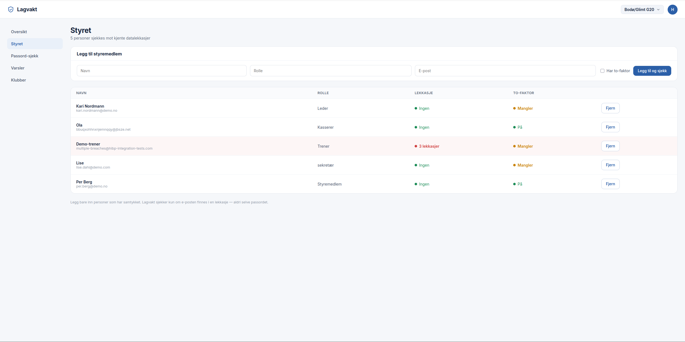
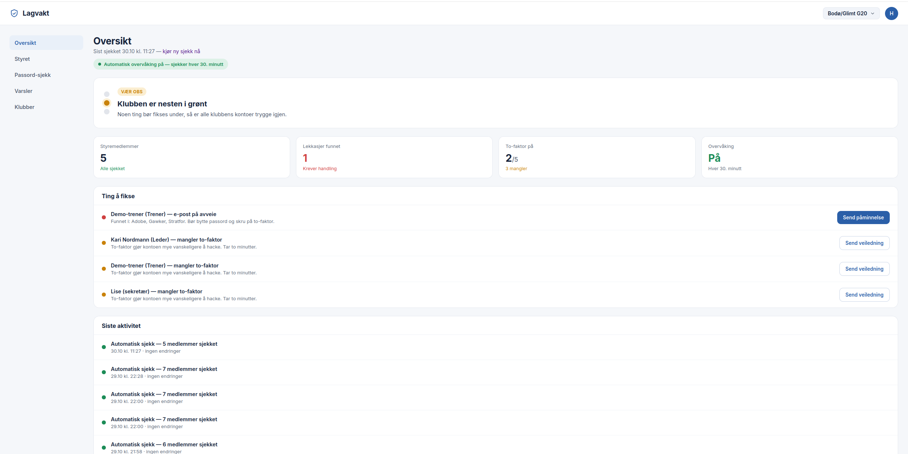
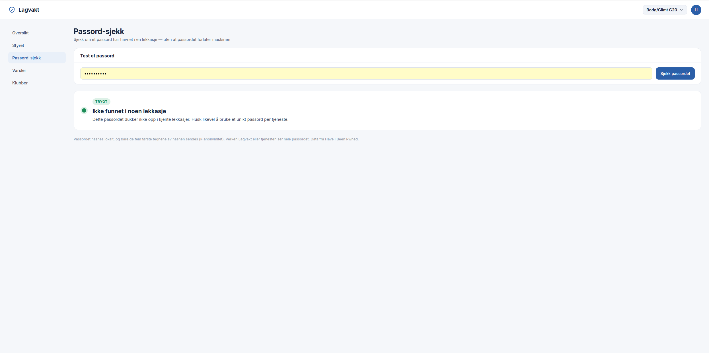
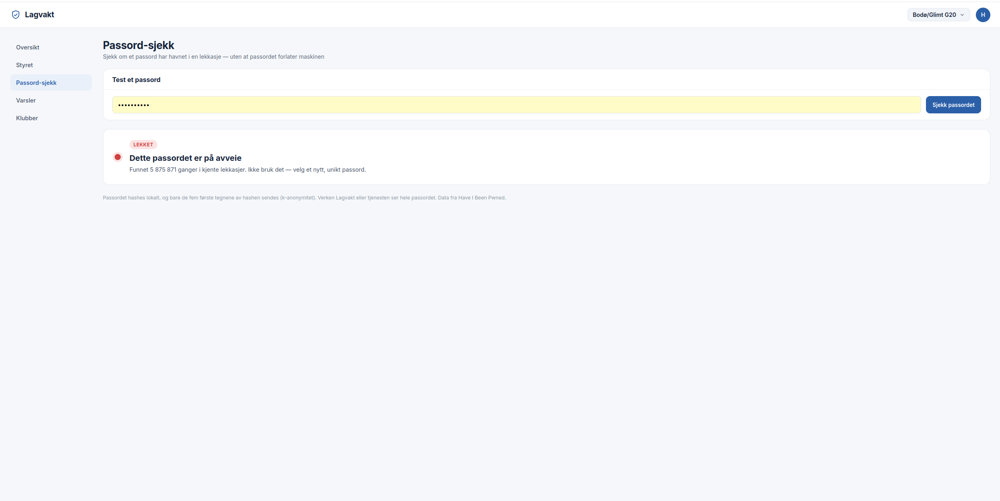

# Lagvakt

Lagvakt er en liten sikkerhetstjeneste for frivillige lag og foreninger. Den
passer på at folkene i et klubbstyre ikke har e-post eller passord på avveie,
og varsler dem på en vennlig måte hvis de har det.

Idrettslag, korps og velforeninger sitter på medlemslister med adresser og
informasjon om barn, men styret er som regel foreldre uten datakompetanse. Den
vanligste måten slike lag blir hacket på, er gjenbrukte passord som allerede er
lekket. Lagvakt fanger akkurat det, og gjør det forståelig med et enkelt
trafikklys.

## Oversikt

Når en i styret logger inn, møtes de av et dashbord som viser klubbens sikkerhet
som ett trafikklys. Tanken er at en travel forelder skal skjønne statusen på to
sekunder, uten teknisk sjargong. Under ligger en liste over konkrete ting som
bør fikses, og en logg over de automatiske sjekkene.

Lagvakt kjører sjekkene i bakgrunnen på en fast tidsplan, ikke bare når noen
åpner appen. På den måten oppdager den nye lekkasjer av seg selv og logger dem,
så styret kan stole på at noen følger med — også når de ikke gjør det selv.

## Styret

Hvert styremedlem legges inn med navn og e-post, og sjekkes mot flere kjente
lekkasjedatabaser. Lagvakt ser kun *om* en e-post er funnet i en lekkasje, aldri
selve passordet. Dukker noen opp rødt, kan styret sende en vennlig påminnelse
med ett klikk.

Bak kulissene spør Lagvakt tre kilder samtidig (XposedOrNot, LeakCheck og Have I
Been Pwned) og slår sammen svarene. Hver kilde er skrevet som en egen liten
modul, så det er lett å legge til flere — og hvis én kilde går glipp av noe, kan
en annen fange det.

## Passord-sjekk

Et styremedlem kan også teste om et passord er lekket. Det gjøres med
k-anonymitet: passordet hashes lokalt, og bare de fem første tegnene av hashen
sendes. Verken Lagvakt eller tjenesten får vite hele passordet.

## Slik er det bygd

Lagvakt er en Flask-app med en SQLite-database og en bakgrunns-planlegger
(APScheduler) som kjører lekkasjesjekkene jevnlig. Brukere logger inn med
hashede passord, og hver bruker ser kun sine egne klubber.

| Fil | Ansvar |
|-----|--------|
| app.py | Webapp, ruter og bakgrunns-planlegger |
| db.py | Database (brukere, klubber, medlemmer, logg) |
| aggregator.py | Spør alle lekkasjekilder og slår sammen svaret |
| kilder/ | Én adapter per datakilde |
| passord_sjekk.py | Passord-sjekk med k-anonymitet |
| templates/ | Grensesnittet |

## Sikkerhet og personvern

Lagvakt er bygget for en sensitiv kontekst — lag med barn — så personvern er en
del av designet, ikke en ettertanke. Passord lagres hashet og aldri i klartekst,
lekkasjesjekken avslører aldri selve passordet, og passord-sjekken sender aldri
passordet videre. Hver bruker ser bare sine egne data, og Lagvakt bruker kun
seriøse kilder, aldri tjenester som selger passord i klartekst.

## Kjør lokalt

    python3 -m venv .venv && source .venv/bin/activate
    pip install flask requests python-dotenv apscheduler
    python app.py

Åpne http://127.0.0.1:5000 og opprett en konto.

## Videre arbeid

Dette er en fungerende MVP. For å bli en tjeneste klubber kan ta i bruk på
ordentlig, er de neste stegene en samtykke-flyt der hvert medlem bekrefter at de
kan sjekkes, ekte varsler på SMS eller e-post, integrasjon mot Spond eller
StyreWeb for å hente styret automatisk, og vanlig produksjonssikkerhet.

## Attribusjon

Lekkasjedata brukes blant annet fra Have I Been Pwned (haveibeenpwned.com) under
deres Creative Commons-lisens.

## Ansvarsfraskrivelse

Personlig læringsprosjekt og MVP. Skal kun brukes på e-poster og passord man selv
eier eller har fått samtykke til å sjekke.
